# Assignment 2 - Database Design Process from start to finish using MySQL Workbench
This assignment will meet the following objectives:

**Course Objectives:**
1. Organize data in ways to emphasize relationships 

2. Perform CRUD operations from both relational and NoSQL databases 

**Weekly Objectives:**

1.  Create advanced SQL queries that make use of the JOIN and HAVE clause
 

## Instructions
For this assignment, you will decide on a problem domain and create a database of your choosing.  This assignment will require you to document business rules and generate a database from the business rules


## Requirements
### Deliverable 1 - Introducing Problem Domain and Business Rules that Identify Relationships ( 10 Points)
For this deliverable, you will propose a problem domain and generate business rules that address the problem domain. The business rules you identify will consist of relationships, constraints, and data you will need to collect. Within the readme file for this repository, you will identify each of the entities along with a brief description describing the purpose of the entity and the data the entity will collect, You will also need to identify the relationships between entities and any assumptions or questions someone would have after reading the business description. You will ultimately decide the answer on behalf of the problem domain when you list your assumptions.
When creating the problem domain and ER Diagram, make sure your database contains a **minimum of 4 tables but no more than 9** with at least **one table serving as an associative entity**.

**Deliverable 1 should be documented within the README.md file of your issued repository - Consider drafting in a Word or Google document first and then translating into Markdown language.**

### Deliverable 2 - Creation of MySQL Workbench ER diagram (10 Points)
Using the documentation from Deliverable 1, you will use the business rules to create an ER Diagram within MySQL Workbench. When accomplishing this deliverable, make sure to adhere to the following items below.
1. Make sure all of the relationships are properly structured using bi-directional statements 
2. Make sure column names are marked as null vs. not null.
3. Make sure entities that are considered weak properly cascade when a record from the strong entity is deleted.


### Deliverable 3 - Database querying (10 Points)
For this Deliverable, you will insert data and query your database. You will need to demonstrate your ability to query from each table in your database. Create a file called **assignment2.sql** and add the following queries into the file.  You will need to take a screenshot of the rendered output for each command and place a screenshot of your output beneath each of the queries you identify.  Make sure to place a SQL comment above each command identifying the query.  Whether you create the database schema using the database modeling tool in MySQL workbench or by some other means, you will need to provide the commands used to create the database and related tables.  the images of your repository can be uploaded to the repository and referenced in your README.md file by using this Markdown syntax ``````   In order to make changes to the data, you may need to change the SQL Editor settings.  You can do this by navigating to EDIT -> SQL Editor -> and unchecking Safe Updates.  It is advised to restart MySQL Workbench after changing this setting.

#### Listed below is a list of requirements for this deliverable
1. Each table should consist of 5 or more records.  Make sure to include the insert queries in your assignment2.sql file
2. Three different SELECT statements that query each table in your database.  
3. Demonstrate your ability to perform a JOIN statement
 

## Submission Guidelines

For this assignment, you will submit 2 items to the repository that has been assigned to you.  The two items that you will need to submit are listed below: 
1. The README.MD file that includes screenshots of the result grid window for each SQL query
   1. Include the image beneath each query.
   2. The **assignment2.sql** file.  The assignment2.sql file should be 
      uploaded to your repository

Once you have completed both items above, you will need to submit the link to your repository for assignment 2 prior to the due date and time listed.  Make sure you receive an email confirmation notifying you that the assignment has been submitted.

### Rubric
| Criteria           | Description                             | Points |
| -------------------| --------------------------------------- | ------ |
| `**PLO Component**: Organize data in ways to emphasize relationships` <br> Deliverable 1 - Introducing Problem Domain and Business Rules that identify Relationships    | Brief description of problem domain/database prompt.  What database are you creating and what purpose will it server (4pts) <br> Documentation of Business Rules that include: Entity description with possible attributes, Relationship amongst entities, anwsered assumptions that address the cardinality, and questions someone would have after reading the problem domain. (6pt)  |   10   |
| `**PLO Component**: Elicit Information from a database that allows data to be visualized` <br> Deliverable 2 - Creating MySQL Workbench ER diagram | All Entities identified in deliverable 1 are visually represented in Workbench ER diagram. * A minimum of 4 entities with at least 1 being an associative entity. (6pts) <br> Relationship strength is indicated by solid or dotted line (2pt) <br> Each column name indicates null vs not null (2pts)   |   10   |
| `**PLO Component**: Elicit Information from a database that allows data to be mined` <br> Deliverable 3 - Database Querying     |  Each table has 5 or more records (2pt)  <br> Three distinct queries for each table using the ```SELECT``` statement  (4pts) <br> Demonstration to perform a JOIN statement (2pts) <br> README.md file provides the SQL command and screenshot of output of each query.  (1pt)   |  10  |
|           |        |**Total Points:   30**   |

## Lab Resources
- [W3 Schools SQL tutorial](https://www.w3schools.com/sql/)
- [Make a ReadMe file Web-based Editor](https://www.makeareadme.com/)

## Completed Work

### Deliverable 1 - Requirements

#### Problem domain

I have a growing inventory of servers, computers, and various network devices. I also have the added complexity of multiple switches, wireless access points (WAPs), and VLANs. When I add a new device or need to troubleshoot an issue, I can spend a lot of time trying to figure out what is already configured. Problems such as conflicting IP addresses or incorrect VLAN configuration can cause significant issues.

To address this, I will create a database that tracks hosts, network devices, IP address assignments, and the connections between them within one managed network. A network device may be a switch or a WAP. A host, such as a server or workstation, may connect through a network interface controller (NIC) to a connection point provided by a network device. A connection point represents either a physical port or a wireless network identified by an SSID on a particular WAP.

The database will maintain a list of hosts, including computers and other managed devices. Each host may have multiple NICs. Each NIC belongs to one host, may connect to one connection point, and may have zero or more IP addresses assigned to it. Each connection point belongs to one network device and may have zero or more VLAN assignments. The database will record current assignments so I can review how devices are connected and which IP addresses are already in use.

#### Entity Descriptions

- **HOST** is a managed device, such as a server or workstation, that can connect to the network through a **NIC**. The **HOST** has:
  - A `host_id` that provides a unique identifier for the **HOST**.
  - A `hostname` that records the name assigned to the **HOST**.
  - A `description` that provides free text explaining what the **HOST** does.
- **NIC** is a network interface belonging to a **HOST**. It records the interface's identity, its connection to a **CONNECTION_POINT**, and its relationship to assigned **IP** records. The **NIC** has:
  - A `nic_id` that provides a unique identifier for the **NIC**.
  - A `host_id` that identifies the **HOST** to which the **NIC** belongs.
  - An `interface_name` that records the interface's name on the **HOST**, such as `eth0`.
  - A `mac` that records the interface's MAC address. This address must be unique within the NIC inventory.
  - A `connection_point_id` that identifies the **CONNECTION_POINT** connected to the **NIC**. This field is optional and is NULL when the NIC has no connection to a connection point represented in this database.
- **IP** records an IP address assigned to a **NIC**. A NIC may have zero or more IP addresses, but each **IP** record belongs to exactly one NIC. The **IP** has:
  - An `ip_id` that provides a unique identifier for the **IP** record.
  - A `nic_id` that identifies the **NIC** to which the IP address is assigned.
  - An `ip` that records the assigned IP address.
- **NETWORK_DEVICE** is a managed switch or WAP that provides connection points through which hosts can connect to the network. The **NETWORK_DEVICE** has:
  - A `device_id` that provides a unique identifier for the **NETWORK_DEVICE**.
  - A `device_type` that identifies whether the **NETWORK_DEVICE** is a switch or a WAP.
  - A `name` that provides a name for the **NETWORK_DEVICE**.
  - A `description` that provides free text for additional information about the **NETWORK_DEVICE**.
- **CONNECTION_POINT** is a physical port or a wireless network offered by a **NETWORK_DEVICE**. A wireless connection point represents one SSID on one particular WAP. A wired connection point may connect to zero or one **NIC**, while a wireless connection point may connect to zero or more **NIC** records. Either type may have zero or more **VLAN** assignments. The **CONNECTION_POINT** has:
  - A `connection_point_id` that provides a unique identifier for the **CONNECTION_POINT**.
  - A `device_id` that identifies the **NETWORK_DEVICE** to which the connection point belongs.
  - A `connection_type` that identifies whether the **CONNECTION_POINT** is wired or wireless.
  - A `name` that identifies the physical port or wireless SSID, such as `Port 8` or `Office Wi-Fi`.
  - An `is_enabled` value that records whether the connection point is administratively enabled for use. It is true when enabled and false when disabled.
- **VLAN** is a virtual local area network that defines a logical network segment. The **VLAN** has:
  - A `vlan_id` that provides a unique identifier for the **VLAN** record in the database.
  - A `vlan_tag` that records the numeric identifier used for the **VLAN** on the network.
  - A `name` that provides a name for the **VLAN**.
- **CONNECTION_POINT_VLAN** connects **CONNECTION_POINT** records to their assigned **VLAN** records. It is the associative entity that resolves the many-to-many relationship between connection points and VLANs. The **CONNECTION_POINT_VLAN** has:
  - A `connection_point_id` that identifies the **CONNECTION_POINT** in the assignment.
  - A `vlan_id` that identifies the **VLAN** assigned to that connection point.

#### Relationships

- A **HOST** may <ins>have</ins> zero or more **NIC** records. Each **NIC** must <ins>have</ins> exactly one **HOST**.
- A **NIC** may be <ins>assigned</ins> zero or more **IP** records. Each **IP** record must be <ins>assigned</ins> to exactly one **NIC**.
- A **NETWORK_DEVICE** may <ins>own</ins> zero or more **CONNECTION_POINT** records. Each **CONNECTION_POINT** must be <ins>owned</ins> by exactly one **NETWORK_DEVICE**.
- A **NIC** may <ins>connect</ins> to zero or one **CONNECTION_POINT**. Each **CONNECTION_POINT** may <ins>connect</ins> to zero or more **NIC** records. For wired connection points, the maximum is one NIC.
- A **CONNECTION_POINT** may <ins>have</ins> zero or more **CONNECTION_POINT_VLAN** records. Each **CONNECTION_POINT_VLAN** record must <ins>have</ins> exactly one **CONNECTION_POINT**.
- A **VLAN** may <ins>have</ins> zero or more **CONNECTION_POINT_VLAN** records. Each **CONNECTION_POINT_VLAN** record must <ins>have</ins> exactly one **VLAN**.

#### Assumptions

- Does the database represent one managed network? **YES**
- Must each IP address be unique across the managed network, even when devices are assigned to different **VLAN** records? **YES**
- Does the database record only current configuration and assignments, without maintaining a history of previous configurations? **YES**
- Can a **NETWORK_DEVICE** represent either a switch or a WAP? **YES**
- Can a WAP have both wired and wireless **CONNECTION_POINT** records? **YES**
- Does each wireless **CONNECTION_POINT** represent one SSID offered by one particular WAP? **YES**
- Can the same SSID be recorded on different WAPs as separate **CONNECTION_POINT** records? **YES**
- Can a **HOST** be recorded before any **NIC** records are associated with it? **YES**
- Can a **NETWORK_DEVICE** be recorded before its **CONNECTION_POINT** records are entered? **YES**
- Can a **NIC** have no **IP** records assigned to it? **YES**
- Can a **NIC** have more than one **IP** record assigned to it? **YES**
- Can `connection_point_id` be NULL when a **NIC** has no connection to a connection point represented in this database, even if it has network connectivity through another device or interface? **YES**
- Must a wired **CONNECTION_POINT** connect to at most one **NIC** at a time? **YES**
- Can a wireless **CONNECTION_POINT** connect to multiple **NIC** records at the same time? **YES**
- Can a **VLAN** exist without being assigned to any **CONNECTION_POINT** records? **YES**
- Can a **CONNECTION_POINT** have no **VLAN** assignments or have multiple **VLAN** assignments? **YES**
- Can a **NIC** retain its assigned **IP** records while disconnected from a **CONNECTION_POINT**? **YES**
- Can a **CONNECTION_POINT** retain its **VLAN** assignments when no NIC is connected or when `is_enabled` is false? **YES**
- Must the combination of `connection_point_id` and `vlan_id` be unique in **CONNECTION_POINT_VLAN**, preventing duplicate assignments of the same VLAN to the same connection point? **YES**

### Deliverable 2 - ERD

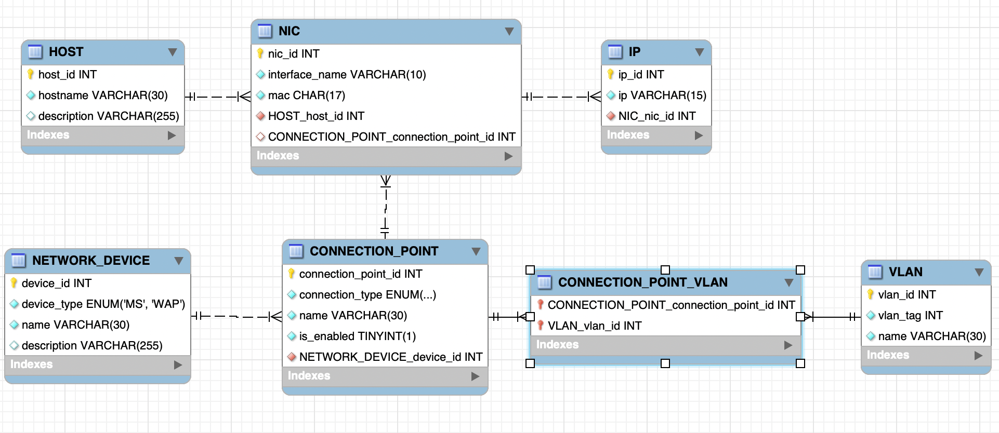

### Deliverable 3 - Database querying

#### SQL for HOST

```
-- 1 - List all hosts alphabetically by hostname.
SELECT *
FROM host
ORDER BY hostname;
```
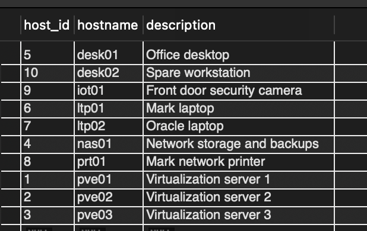

```
-- 2 - Find hosts with "server" in their description.
SELECT *
FROM host
WHERE description LIKE '%server%';
```
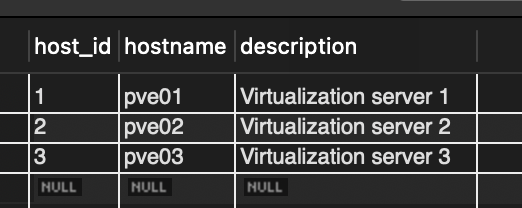

```
-- 3 - Count the total number of hosts in the inventory.
SELECT COUNT(*) AS total_hosts
FROM host;
```


#### SQL for NIC

```
-- 4 - Find network interfaces with no connection point assigned.
SELECT *
FROM NIC
WHERE CONNECTION_POINT_connection_point_id IS NULL;
```
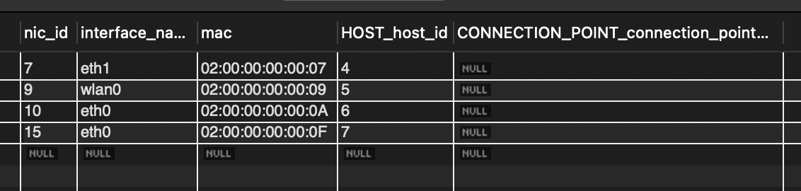

```
-- 5 - List network interfaces with their hostnames and MAC addresses.
SELECT HOST.hostname, NIC.interface_name, NIC.mac
FROM NIC
JOIN HOST ON NIC.HOST_host_id = HOST.host_id
ORDER BY HOST.hostname, NIC.interface_name;
```
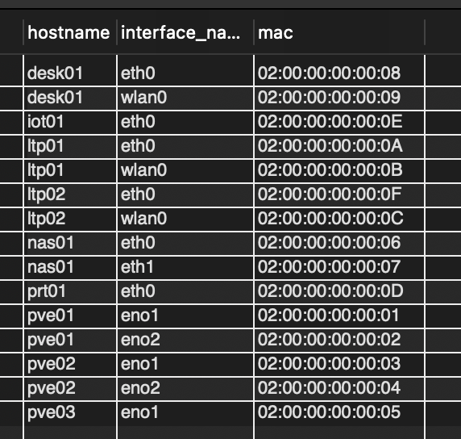

```
-- 6 - Count network interfaces for each host, including hosts with none.
SELECT HOST.hostname, COUNT(NIC.nic_id) AS total_interfaces
FROM HOST
LEFT JOIN NIC ON HOST.host_id = NIC.HOST_host_id
GROUP BY HOST.host_id, HOST.hostname
ORDER BY HOST.hostname;
```
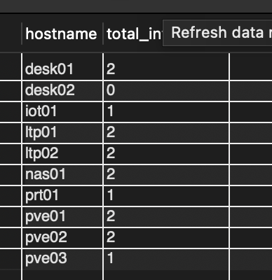

#### SQL for IP

```
-- 7 - List IP addresses with their hostnames and interface names.
SELECT HOST.hostname, NIC.interface_name, IP.ip
FROM IP
JOIN NIC ON IP.NIC_nic_id = NIC.nic_id
JOIN HOST ON NIC.HOST_host_id = HOST.host_id
ORDER BY HOST.hostname, NIC.interface_name, IP.ip;
```
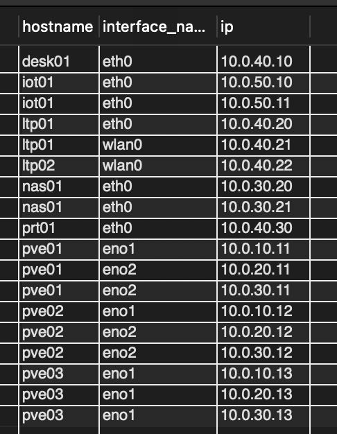

```
-- 8 - Find IP addresses that begin with 10.0.10.
SELECT *
FROM IP
WHERE IP.ip LIKE '10.0.10.%';
```
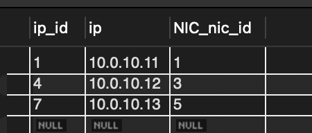

```
-- 9 - Find network interfaces with more than one assigned IP address.
SELECT HOST.hostname, NIC.interface_name, COUNT(IP.ip_id) AS total_ip_addresses
FROM IP
JOIN NIC ON IP.NIC_nic_id = NIC.nic_id
JOIN HOST ON NIC.HOST_host_id = HOST.host_id
GROUP BY HOST.host_id, HOST.hostname, NIC.nic_id, NIC.interface_name
HAVING COUNT(IP.ip_id) > 1
ORDER BY HOST.hostname, NIC.interface_name;
```
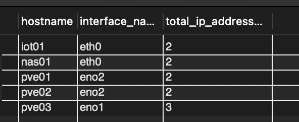

#### SQL for NETWORK_DEVICE

```
-- 10 - List network devices by type and name.
SELECT name, device_type, description
FROM NETWORK_DEVICE
ORDER BY device_type, name;
```
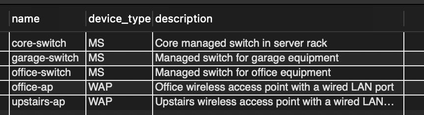

```
-- 11 - Count connection points for each device by connection type.
SELECT NETWORK_DEVICE.name, CONNECTION_POINT.connection_type,
       COUNT(CONNECTION_POINT.connection_point_id) AS total_connection_points
FROM NETWORK_DEVICE
LEFT JOIN CONNECTION_POINT
    ON NETWORK_DEVICE.device_id = CONNECTION_POINT.NETWORK_DEVICE_device_id
GROUP BY NETWORK_DEVICE.device_id, NETWORK_DEVICE.name,
         CONNECTION_POINT.connection_type
ORDER BY NETWORK_DEVICE.name, CONNECTION_POINT.connection_type;
```
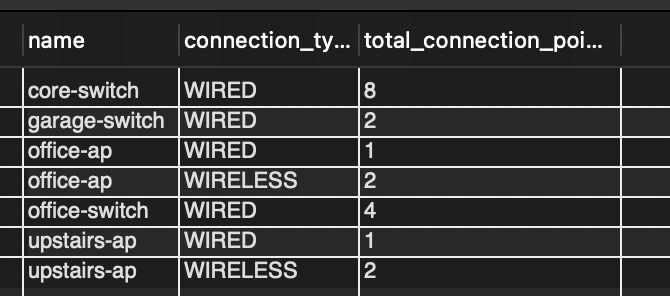

```
-- 12 - List devices and their disabled connection points.
SELECT NETWORK_DEVICE.name AS device_name,
       CONNECTION_POINT.name AS connection_point_name,
       CONNECTION_POINT.connection_type
FROM NETWORK_DEVICE
JOIN CONNECTION_POINT
    ON NETWORK_DEVICE.device_id = CONNECTION_POINT.NETWORK_DEVICE_device_id
WHERE CONNECTION_POINT.is_enabled = 0
ORDER BY NETWORK_DEVICE.name, CONNECTION_POINT.name;
```
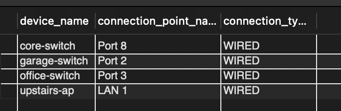

#### SQL for CONNECTION_POINT

```
-- 13 - Find enabled wired connection points with no NIC connected.
SELECT NETWORK_DEVICE.name AS device_name,
       CONNECTION_POINT.name AS connection_point_name
FROM CONNECTION_POINT
JOIN NETWORK_DEVICE
    ON CONNECTION_POINT.NETWORK_DEVICE_device_id = NETWORK_DEVICE.device_id
LEFT JOIN NIC
    ON CONNECTION_POINT.connection_point_id = NIC.CONNECTION_POINT_connection_point_id
WHERE CONNECTION_POINT.connection_type = 'WIRED'
  AND CONNECTION_POINT.is_enabled = 1
  AND NIC.nic_id IS NULL
ORDER BY NETWORK_DEVICE.name, CONNECTION_POINT.name;
```
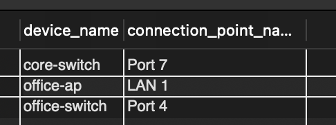

```
-- 14 - Count connected NICs for each wireless connection point, including those with none.
SELECT NETWORK_DEVICE.name AS device_name,
       CONNECTION_POINT.name AS ssid,
       COUNT(NIC.nic_id) AS total_connected_nics
FROM CONNECTION_POINT
JOIN NETWORK_DEVICE
    ON CONNECTION_POINT.NETWORK_DEVICE_device_id = NETWORK_DEVICE.device_id
LEFT JOIN NIC
    ON CONNECTION_POINT.connection_point_id = NIC.CONNECTION_POINT_connection_point_id
WHERE CONNECTION_POINT.connection_type = 'WIRELESS'
GROUP BY NETWORK_DEVICE.device_id, NETWORK_DEVICE.name,
         CONNECTION_POINT.connection_point_id, CONNECTION_POINT.name
ORDER BY NETWORK_DEVICE.name, CONNECTION_POINT.name;
```
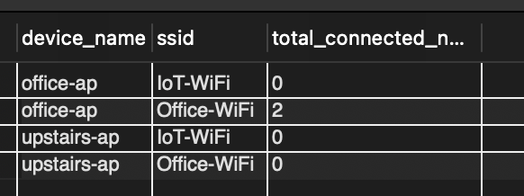

```
-- 15 - Find connection points with no VLAN assigned.
SELECT NETWORK_DEVICE.name AS device_name,
       CONNECTION_POINT.name AS connection_point_name,
       CONNECTION_POINT.connection_type
FROM CONNECTION_POINT
JOIN NETWORK_DEVICE
    ON CONNECTION_POINT.NETWORK_DEVICE_device_id = NETWORK_DEVICE.device_id
LEFT JOIN CONNECTION_POINT_VLAN
    ON CONNECTION_POINT.connection_point_id = CONNECTION_POINT_VLAN.CONNECTION_POINT_connection_point_id
WHERE CONNECTION_POINT_VLAN.VLAN_vlan_id IS NULL
ORDER BY NETWORK_DEVICE.name, CONNECTION_POINT.name;
```
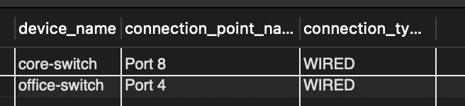

#### SQL for VLAN

```
-- 16 - List defined VLANs by VLAN tag.
SELECT vlan_tag, name
FROM VLAN
ORDER BY vlan_tag;
```
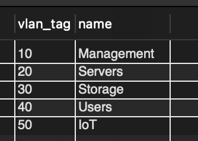

```
-- 17 - Count connection points assigned to each VLAN, including VLANs with none.
SELECT VLAN.vlan_tag, VLAN.name,
       COUNT(CONNECTION_POINT_VLAN.CONNECTION_POINT_connection_point_id) AS total_connection_points
FROM VLAN
LEFT JOIN CONNECTION_POINT_VLAN
    ON VLAN.vlan_id = CONNECTION_POINT_VLAN.VLAN_vlan_id
GROUP BY VLAN.vlan_id, VLAN.vlan_tag, VLAN.name
ORDER BY VLAN.vlan_tag;
```
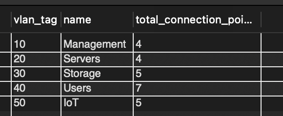

```
-- 18 - List VLANs assigned to wireless connection points and their devices.
SELECT VLAN.vlan_tag, VLAN.name AS vlan_name,
       NETWORK_DEVICE.name AS device_name,
       CONNECTION_POINT.name AS ssid
FROM VLAN
JOIN CONNECTION_POINT_VLAN
    ON VLAN.vlan_id = CONNECTION_POINT_VLAN.VLAN_vlan_id
JOIN CONNECTION_POINT
    ON CONNECTION_POINT_VLAN.CONNECTION_POINT_connection_point_id = CONNECTION_POINT.connection_point_id
JOIN NETWORK_DEVICE
    ON CONNECTION_POINT.NETWORK_DEVICE_device_id = NETWORK_DEVICE.device_id
WHERE CONNECTION_POINT.connection_type = 'WIRELESS'
ORDER BY VLAN.vlan_tag, NETWORK_DEVICE.name, CONNECTION_POINT.name;
```
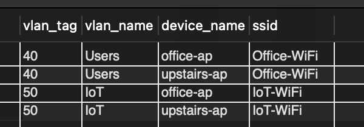

#### SQL for CONNECTION_POINT_VLAN

```
-- 19 - List VLAN assignments with device and connection point names.
SELECT NETWORK_DEVICE.name AS device_name,
       CONNECTION_POINT.name AS connection_point_name,
       VLAN.vlan_tag,
       VLAN.name AS vlan_name
FROM CONNECTION_POINT_VLAN
JOIN CONNECTION_POINT
    ON CONNECTION_POINT_VLAN.CONNECTION_POINT_connection_point_id = CONNECTION_POINT.connection_point_id
JOIN NETWORK_DEVICE
    ON CONNECTION_POINT.NETWORK_DEVICE_device_id = NETWORK_DEVICE.device_id
JOIN VLAN
    ON CONNECTION_POINT_VLAN.VLAN_vlan_id = VLAN.vlan_id
ORDER BY NETWORK_DEVICE.name, CONNECTION_POINT.name, VLAN.vlan_tag;
```
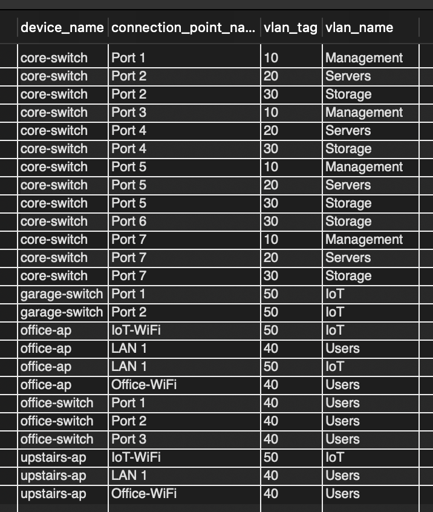

```
-- 20 - Find connection points with more than one VLAN assigned.
SELECT NETWORK_DEVICE.name AS device_name,
       CONNECTION_POINT.name AS connection_point_name,
       COUNT(CONNECTION_POINT_VLAN.VLAN_vlan_id) AS total_vlans
FROM CONNECTION_POINT_VLAN
JOIN CONNECTION_POINT
    ON CONNECTION_POINT_VLAN.CONNECTION_POINT_connection_point_id = CONNECTION_POINT.connection_point_id
JOIN NETWORK_DEVICE
    ON CONNECTION_POINT.NETWORK_DEVICE_device_id = NETWORK_DEVICE.device_id
GROUP BY NETWORK_DEVICE.device_id, NETWORK_DEVICE.name,
         CONNECTION_POINT.connection_point_id, CONNECTION_POINT.name
HAVING COUNT(CONNECTION_POINT_VLAN.VLAN_vlan_id) > 1
ORDER BY NETWORK_DEVICE.name, CONNECTION_POINT.name;
```
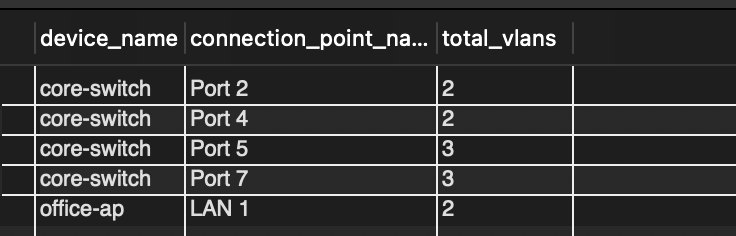

```
-- 21 - List VLAN assignments that remain on disabled connection points.
SELECT NETWORK_DEVICE.name AS device_name,
       CONNECTION_POINT.name AS connection_point_name,
       VLAN.vlan_tag,
       VLAN.name AS vlan_name
FROM CONNECTION_POINT_VLAN
JOIN CONNECTION_POINT
    ON CONNECTION_POINT_VLAN.CONNECTION_POINT_connection_point_id = CONNECTION_POINT.connection_point_id
JOIN NETWORK_DEVICE
    ON CONNECTION_POINT.NETWORK_DEVICE_device_id = NETWORK_DEVICE.device_id
JOIN VLAN
    ON CONNECTION_POINT_VLAN.VLAN_vlan_id = VLAN.vlan_id
WHERE CONNECTION_POINT.is_enabled = 0
ORDER BY NETWORK_DEVICE.name, CONNECTION_POINT.name, VLAN.vlan_tag;
```
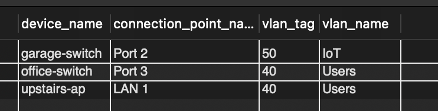

#### Though the assignment doesn't ask for it, I figured some data changes are helpful

```
-- Update the description of the network storage host.
UPDATE HOST
SET description = 'Primary network storage and nightly backups'
WHERE host_id = 4;
```

```
-- 22 - Verify the updated host description.
SELECT host_id, hostname, description
FROM HOST
WHERE host_id = 4;
```
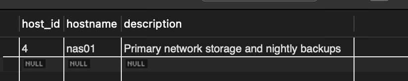

```
-- Enable connection point 8.
UPDATE CONNECTION_POINT
SET is_enabled = 1
WHERE connection_point_id = 8;
```

```
-- 23 - Verify that the connection point is enabled.
SELECT connection_point_id, name, is_enabled
FROM CONNECTION_POINT
WHERE connection_point_id = 8;
```
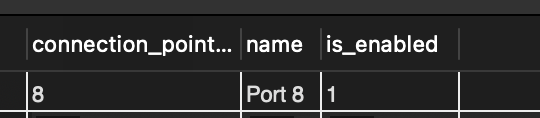